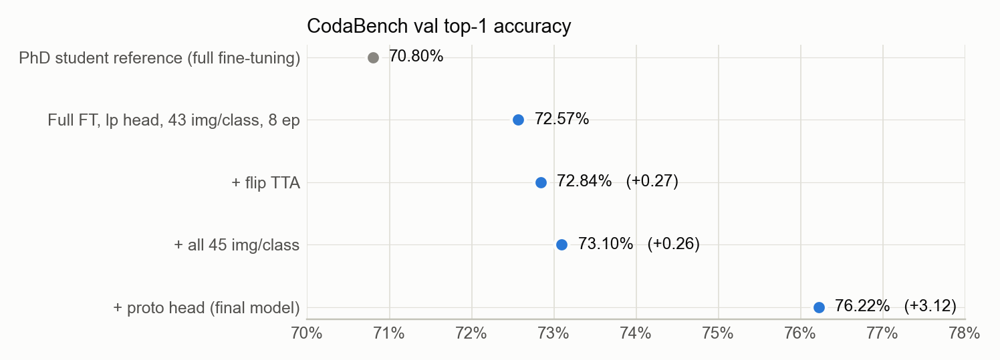
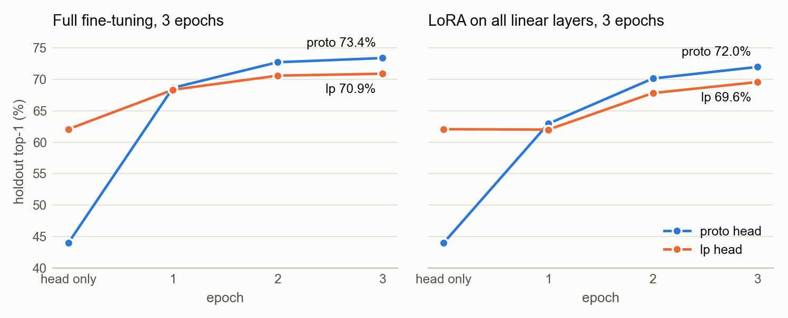
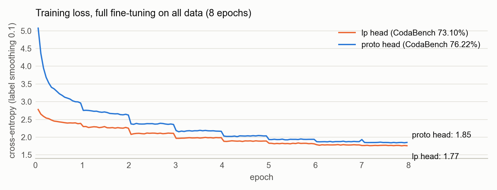

# CS604 项目实验结果汇总

> ViT-B/16 迁移到 10,000 类细粒度分类 · Team 06 · 截至 2026 年 10 月 19 日
> 所有数字均取自各实验的 `summary.json` 和 `train_log.txt`。图片在同目录的 `figures/` 文件夹里。

## 1. 结论速览

- **最终模型**：`1019_1319_1_full`，全量微调 + 类原型（proto）分类头初始化 + 用满 45 张/类 + 8 epoch + 预测时翻转 TTA。CodaBench val **76.22%**，比博士生参考成绩（70.8%）高 5.4 个点。Phase 2 将用它预测测试集。
- **PEFT 最终模型**：`1019_1319_3_lora`，LoRA（r=8）加在所有线性层 + proto 分类头，3 epoch。只训练主干 1.375% 的参数（不含分类头），CodaBench val **71.90%**（holdout 71.98%），比参考 LoRA（68.3%）高 3.6 个点。
- **最大的发现是分类头初始化**：其他条件完全相同时，把 linear probe（lp）初始化换成 proto 初始化，CodaBench 从 73.10% 提到 76.22%（+3.12）。在 holdout 上，全量微调和 LoRA 也都提升了约 2.5 个点。
- **全部在预算内**：每个实验在 A100-80GB 上最多用 1.06 GPU 小时（预算 1.2 小时 = 2 h × 48 GB ÷ 80 GB），显存峰值最多 19.9 GB（上限 48 GB）。

## 2. CodaBench 成绩提升路线

下表每一步只改动一个设置，模型、8 epoch 和其余超参数都相同。CodaBench 的指标是 Top-1 准确率。val 集每类 5 张、类别均衡，所以它也等于 macro recall（每类准确率的平均）。

| 步骤 | 改动 | 实验 | CodaBench val | 提升 |
|---|---|---|---:|---:|
| 参考 | 博士生参考成绩（全量微调） | – | 70.80% | – |
| 1 | 全量微调，lp 分类头，每类 43 张（留 2 张作 holdout） | `0928_0748_1_full` | 72.57% | +1.77（相对参考） |
| 2 | + 预测时翻转 TTA | `0928_0748_1_full` | 72.84% | +0.27 |
| 3 | + 用满 45 张/类 | `1018_2306_1_full` | 73.10% | +0.26 |
| **4** | **+ 分类头改用 proto 初始化（最终模型）** | `1019_1319_1_full` | **76.22%** | **+3.12** |

第 3 步的提升处于随机波动边缘（约 ±0.2–0.3 个点），但方向和预期一致。第 2 步和第 4 步明显超出波动范围。

*图 1　CodaBench val 准确率的提升路线（灰点为博士生参考成绩）。点的位置表示数值，所以横轴从 70% 开始，便于看清差距。*

## 3. 全部实验结果

共 17 个实验运行，按方法分组，**加粗**的是最终模型。Holdout 是从训练集每类留出 2 张（共 20,000 张）做的本地验证集，和 CodaBench 的差距在 0.3 个点以内。

| 实验 | 方法 | 分类头 | Epoch | 可训练参数 | Holdout | CodaBench | GPU 小时 | 显存 GB | 延迟 ms |
|---|---|---|---:|---:|---:|---:|---:|---:|---:|
| **基线** | | | | | | | | | |
| `0928_0636_1_linear` | Zero-shot（proto 分类头，不训练） | proto | 0 | 0 | 43.95% | – | 0.11 | 3.9 | 7.55 |
| （分类头初始化阶段） | Linear probe（只训练分类头） | lp | 10* | 0 | 62.07% | – | ≈0.11 | – | – |
| **全量微调（可训练参数 100%）** | | | | | | | | | |
| `0928_0636_3_full` | 全量微调 | lp | 3 | 100% | 70.88% | – | 0.45 | 18.9 | 7.31 |
| `0928_0748_1_full` | 全量微调 | lp | 8 | 100% | 72.31% | 72.57% / 72.84%‡ | 1.03 | 18.9 | 7.35 |
| `1018_2306_1_full` | 全量微调，用满数据 | lp | 8 | 100% | – | 73.10%‡ | 1.03 | 18.9 | 14.92‡ |
| `1019_1120_1_full` | 全量微调 | proto | 3 | 100% | 73.38% | – | 0.48 | 18.9 | 7.78 |
| `1019_1319_2_full` | 全量微调，用满数据 | proto | 3 | 100% | – | 74.01%‡ | 0.44 | 18.9 | 15.24‡ |
| **`1019_1319_1_full`** | **全量微调，用满数据（最终模型）** | proto | 8 | 100% | – | **76.22%‡** | 1.03 | 18.9 | 14.95‡ |
| **PEFT（参数高效微调）** | | | | | | | | | |
| `0928_0636_2_lora` | LoRA，只加在 qkv | lp | 3 | 0.344% | 68.57% | – | 0.40 | 13.5 | 7.22 |
| `0928_0748_2_lora` | LoRA，只加在 qkv（分类头 LR 2e-4） | lp | 10 | 0.344% | 68.69% | – | 1.06 | 13.5 | 7.53 |
| `1018_1239_1_lora` | LoRA，只加在 qkv（LR 5e-4） | lp | 3 | 0.344% | 68.45% | – | 0.41 | 13.5 | 7.15 |
| `1018_1239_3_adaptformer` | AdaptFormer（bottleneck 64） | lp | 3 | 1.387% | 69.05% | – | 0.39 | 12.8 | 9.89 |
| `1018_1239_2_lora` | LoRA，所有线性层 | lp | 3 | 1.375% | 69.45% | – | 0.55 | 19.9 | 7.03 |
| `1018_2306_2_lora` | LoRA，所有线性层 | lp | 6 | 1.375% | 69.87% | – | 0.97 | 19.9 | 7.31 |
| `1019_0953_1_lora` † | LoRA，所有线性层 | random | 3 | 1.375% | 71.95% | – | 0.37† | 19.9 | 1.81† |
| `1019_0953_2_lora` † | LoRA，所有线性层 | proto | 3 | 1.375% | 72.00% | – | 0.44† | 19.9 | 1.82† |
| `1019_1120_2_lora` | LoRA，所有线性层 | proto | 6 | 1.375% | 71.52% | – | 0.97 | 19.9 | 7.76 |
| **`1019_1319_3_lora`** | **LoRA，所有线性层（PEFT 最终）** | proto | 3 | 1.375% | **71.98%** | **71.90%** | 0.54 | 19.9 | 7.61 |

说明：
- **可训练参数**不含 10,000 类分类头（7,690,000 个参数，相当于主干 85,798,656 个参数的 9.0%）。算上分类头时，LoRA 所有线性层为 10.3%，LoRA 只加在 qkv 为 9.3%。
- **“–”**：用满 45 张/类训练的实验没有 holdout；没有提交 CodaBench 的实验也记为“–”。
- **\*** Linear probe 在冻结特征上训练 10 个 epoch，只需几秒，GPU 时间主要花在提取特征上。
- **‡** 预测时带翻转 TTA，推理延迟约为原来的 2 倍。
- **†** 在 RTX PRO 6000 Blackwell 上运行，其余均为 A100-SXM4-80GB。GPU 型号不影响准确率，但速度和延迟不可比。
- **显存**为训练时 PyTorch 已分配显存的峰值。PyTorch 预留的显存略高，比如最终模型为 20.1 GB。
- **延迟**为 batch 1、bf16、只计前向。同一结构在不同实验间有约 ±0.4 ms 的测量波动。

## 4. 消融实验

### 4.1 分类头初始化（影响最大）

| 设置 | random | proto | lp |
|---|---:|---:|---:|
| LoRA 所有线性层，3 epoch（holdout） | 71.95% † | 72.00% †；A100 重跑 71.98% | 69.45% |
| 全量微调，3 epoch（holdout） | – | **73.38%** | 70.88% |
| 全量微调，用满数据，8 epoch，TTA（CodaBench） | – | **76.22%** | 73.10% |

- lp 分类头在训练前的准确率最高（62.07%，proto 只有 44.01%），但训练结束后反而最差，在三组对比里都落后 proto 约 2.5–3.1 个点。
- 最可能的原因：lp 分类头是在**同一批训练图片**的冻结特征上预先训练的，相当于提前背熟了训练集。所以训练一开始 loss 就很低，传回主干的学习信号很弱；主干特征一变，这个分类头又对不上了。LoRA 实验里，lp 版本第 1 个 epoch 的训练 loss 从 2.22 升到 2.69，原因就在这里。
- proto 只用每类特征的平均值，保留了类别信息（起步快），又没有过度拟合训练集。random 和 proto 最终打平（71.95% vs 72.00%），但 proto 前期收敛更快。

*图 2　分类头初始化对 holdout 准确率的影响。横轴 “head only” 是训练前只靠分类头的准确率，之后是每个 epoch 结束时的值。左：全量微调；右：LoRA 所有线性层。*

*图 3　全量微调（用满数据、8 epoch）的训练 loss。proto 的训练 loss 一直更高（第 8 个 epoch 平均 1.85 vs 1.77），CodaBench 却高 3.12 个点，说明 lp 版本更多是在记住训练图片。loss 每到新的 epoch 就降一截、epoch 内基本不动，这也是记住训练图片的表现。*

### 4.2 PEFT 的方法和设置（均为 lp 分类头、3 epoch、holdout）

| 设置 | 可训练参数 | Holdout | 训练速度 | 显存 | 延迟 bs1 |
|---|---:|---:|---:|---:|---:|
| LoRA 只加在 qkv（基准） | 0.344% | 68.57% | 1,341 张/秒 | 13.5 GB | 7.22 ms |
| LoRA 只加在 qkv，学习率 1e-3 → 5e-4 | 0.344% | 68.45% | 1,353 张/秒 | 13.5 GB | 7.15 ms |
| **LoRA 所有线性层（qkv、proj、fc1、fc2）** | 1.375% | **69.45%** | 885 张/秒 | 19.9 GB | 7.03 ms |
| AdaptFormer（并联在 MLP 旁，bottleneck 64） | 1.387% | 69.05% | 1,437 张/秒 | 12.8 GB | 9.89 ms |
| （对照）全量微调 | 100% | 70.88% | 1,131 张/秒 | 18.9 GB | 7.31 ms |

- **容量比学习率重要**：学习率减半几乎没有变化（−0.12，在随机波动范围内）。把 LoRA 从 qkv 扩展到所有线性层（同时调整 MLP），提升 0.88 个点，参数仍只有 1.375%。
- **AdaptFormer** 准确率接近，但它的模块无法合并回主干，batch 1 延迟 9.89 ms，比可以合并的 LoRA（约 7.3 ms）高约 35%。
- **PEFT 省的是可训练参数和存储，不一定省训练时间和显存**：
  - 存储：LoRA 的权重文件约 36 MB（其中约 31 MB 是分类头），全量微调约 374 MB。
  - 训练时间：LoRA 所有线性层的训练速度（885 张/秒）反而低于全量微调（1,131 张/秒）。
  - 显存：LoRA 所有线性层也略高（19.9 vs 18.9 GB）。

### 4.3 训练长度

| 设置 | 较短 | 较长 | 变化 |
|---|---:|---:|---:|
| 全量微调，lp（holdout） | 3 epoch：70.88% | 8 epoch：72.31% | +1.43 |
| 全量微调，proto，用满数据 + TTA（CodaBench） | 3 epoch：74.01% | 8 epoch：76.22% | **+2.21** |
| LoRA 只加在 qkv，lp（holdout）* | 3 epoch：68.57% | 10 epoch：68.69% | +0.12 |
| LoRA 所有线性层，lp（holdout） | 3 epoch：69.45% | 6 epoch：69.87% | +0.42 |
| LoRA 所有线性层，proto（holdout） | 3 epoch：71.98% | 6 epoch：71.52% | −0.46 |

\* 10 epoch 的那次把分类头学习率降到了 2e-4，其余设置相同。

全量微调用较小的学习率（1e-4），而且越靠前的层学习率越低，所以训练越久越好。LoRA 的学习率较高（1e-3），大约 3 个 epoch 后就开始过拟合，用 proto 时 6 epoch 反而比 3 epoch 低。

### 4.4 TTA 和训练数据量（CodaBench）

| 改动 | 之前 | 之后 | 变化 |
|---|---:|---:|---:|
| 预测时翻转 TTA（模型不变，`0928_0748_1_full`） | 72.57% | 72.84% | +0.27，推理延迟约翻倍 |
| 每类训练图片 43 → 45 张（都带 TTA，lp 分类头） | 72.84% | 73.10% | +0.26 |

## 5. 主要发现（可直接用于报告）

1. **分类头初始化是最关键的设计**：proto ≈ random，都明显好于 lp。在 1 万类、每类只有 45 张图的设定下，用训练集特征预先拟合分类头（lp）会削弱主干的学习。
2. **本地 holdout 可靠**：holdout 和 CodaBench 相差不到 0.3 个点（72.31% vs 72.57%；71.98% vs 71.90%）。消融实验可以只看 holdout，节省提交次数。
3. **结果可复现**：同一设置在 RTX PRO 6000 和 A100 上分别得到 72.00% 和 71.98%。
4. **训练长度的规律相反**：全量微调训练越久越好（3 → 8 epoch：+2.21）；LoRA 约 3 个 epoch 就饱和，再训练会过拟合。
5. **PEFT 的瓶颈在容量而不在学习率**：LoRA 加到所有线性层效果最好。它只用 1.375% 的参数，就达到同设置全量微调成绩的 98%（71.98% vs 73.38%，均为 3 epoch、proto）。
6. **可以合并的 PEFT 更适合部署**：LoRA 合并后推理零额外开销；AdaptFormer 推理延迟高约 35%。
7. **翻转 TTA** 稳定 +0.27 个点，代价是推理延迟翻倍；**用满训练数据** +0.26 个点。

## 6. 实现细节与计算预算

- **基座模型**：timm `vit_base_patch16_224.augreg2_in21k_ft_in1k`（IN21K→IN1K），主干 85,798,656 个参数；新的 10,000 类分类头 7,690,000 个参数。
- **数据**：训练集每类 45 张。调参和消融时每类留出 2 张作 holdout（共 20,000 张），只在训练集内部切分；最终模型用满 45 张/类。val 和 test 只用于生成提交文件。
- **通用训练设置**：
  - 优化：AdamW，warmup 后 cosine 衰减，bf16 混合精度，batch 256。
  - 正则：label smoothing 0.1，梯度裁剪 1.0。
  - 数据增强：RandomResizedCrop（面积 0.25–1）+ 水平翻转。
- **全量微调**：学习率 1e-4，weight decay 0.05，逐层学习率衰减 0.75，drop path 0.1。
- **LoRA**：r=8，α=16，学习率 1e-3（分类头相同），weight decay 1e-4。训练后合并回主干，推理没有额外开销。
- **AdaptFormer**：bottleneck 64，缩放 0.1，并联在 MLP 旁。
- **proto 分类头**：用冻结的主干提取训练集特征，每类特征 L2 归一化后取平均，再乘以拟合得到的温度（40）作为分类头权重。提取特征在 A100 上约 6–7 分钟，计入每个实验的 GPU 时间。
- **计算预算**：PDF 规定 2 小时 × 48 GB = 96 GB·h，按显卡显存换算，A100-80GB 每个实验 1.2 小时（允许 ±10%）。
  - 计入 GPU 时间的：分类头初始化（含提取特征）、训练、每个 epoch 末的 holdout 评估。
  - 不计入的：解压数据、保存 checkpoint、最终预测。
- **推理延迟**：随机输入，只计前向，bf16，A100。batch 256 的吞吐量约 3,850 张/秒。开翻转 TTA 时每张图要算两遍，延迟约翻倍。
- **软件版本**：torch 2.11.0+cu130、timm 1.0.30、peft 0.21.1。这是从 `1019_1120` 这一批开始记录的；更早的实验用的是当时 pip 安装的最新版本，没有记录。
- **硬件**：除 `1019_0953` 这一批在 RTX PRO 6000 Blackwell 上运行外，其余全部在 A100-SXM4-80GB（12 个 CPU）上运行。

## 7. 下一步

- **Phase 2（10/31–11/6）**：
  1. 先重跑下载数据的 notebook，把测试集存到 Drive。
  2. 把 `PHASE2_TEST` 设为 `True`，选 A100，然后 Run all。
  3. 核对 val 的日志是否为 `50,000 predictions over 9,992 classes (max 13 per class)`。一致后再上传 test 的提交文件（共 2 次机会）。
- **报告和 slides 还需要**：
  - 组员姓名和学号
  - 报告页数限制
  - 基座模型（IN21K→IN1K）是否已经和助教确认
- **时间节点**：展示 11/7（15 分钟 + 5 分钟问答）；报告 11/18 截止（CVPR LaTeX 模板）。
